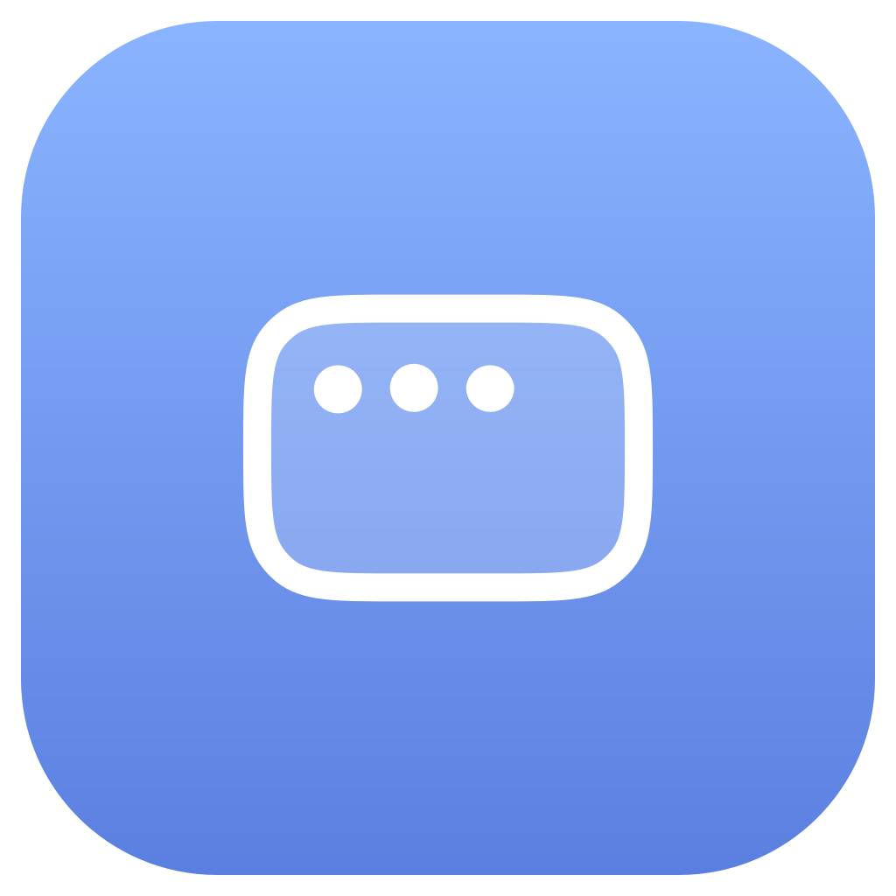
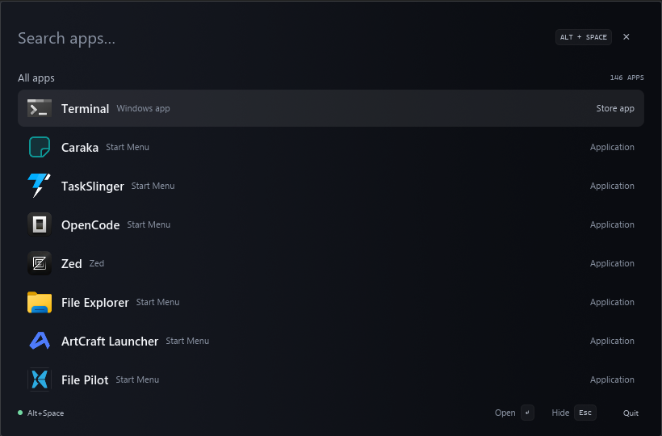

# Pirsa



A fast, keyboard-first launcher for Windows, built with **Rust** and **iced**.

Repository: [github.com/gunungpw/pirsa](https://github.com/gunungpw/pirsa)



Press **Alt+Space** (the default) anywhere to open it, type a few letters, press
**Enter**. Pirsa searches the Start Menu (including Store/UWP apps) and gets out
of the way.

## Features

- **Open from anywhere** — the app lives in the background with no taskbar
  button. The global hotkey defaults to **Alt+Space** and can be changed in
  Settings.
- **Start Menu search** — indexes both per-user and all-user Start Menu
  shortcuts, plus the Windows `AppsFolder` namespace used by Store/UWP apps such
  as Settings and Calculator.
- **Fuzzy matching** — prefix, substring, word-boundary, acronym (`vsc` →
  Visual Studio Code) and subsequence matches, ranked sensibly.
- **Frequently used first** — apps you launch most often rise to the top of the
  list and win close search ties. The history is saved to
  `%LOCALAPPDATA%\Pirsa\usage.txt`.
- **Calculator** — type `2 * (3 + 4)` or `sqrt(16)` and the answer appears above
  the app list. Press Enter to copy it.
- **Unit conversion** — type `1 inch` to see it converted to millimetres,
  centimetres, metres, feet, yards, miles and kilometres, or use
  `1 inch to cm` for a single target.
- **Folder search** — start the query with `~` or `>` to search the folders in
  your profile instead of the Start Menu: `~projects` finds your project folders
  wherever they live. Enter opens the selected folder in Explorer.
- **Real application icons** — every row shows the app's actual Windows icon,
  read from the shell for both Start Menu shortcuts and Store apps, with a
  colored initial tile only as a fallback. Icons are cached on disk, so later
  launches only ask the shell about new or updated apps.
- **Keyboard-first** — arrow keys to move, Enter to launch, **Ctrl+1…8** to
  launch a row directly, **Tab** for Settings, Esc to hide. Uninstallers,
  readmes, and website shortcuts are filtered out of the app list.
- **One instance** — launching `pirsa.exe` again reveals the running launcher
  instead of starting a second copy.
- **Tray icon** — left-click it to open Pirsa; right-click for **Open**,
  **Settings**, and **Quit**. The icon is restored automatically if Explorer
  restarts.
- **Settings window** — change UI, app-name, and category fonts independently,
  choose Light, Dark, Nord, Dracula, Gruvbox, Catppuccin, Tokyo Night, or
  Solarized themes, and pick the global hotkey. Changes apply immediately and
  persist in `%LOCALAPPDATA%\Pirsa\settings.txt`.
- **Focus-aware** — hiding returns focus to the window you came from; clicking
  elsewhere auto-hides the launcher.
- **Native and small** — one executable, no WebView, no runtime dependencies.
- **GPU-accelerated** — frames are drawn with `wgpu` on Direct3D 12/Vulkan
  instead of a CPU rasterizer, using gamma-space (`web-colors`) blending so the
  palette matches the original design.
- **Fast start** — the window appears immediately while Start Menu indexing
  finishes in the background.
- **Proper Windows icon** — embedded in the executable and shortcuts, with
  product/version metadata shown in Explorer and Task Manager.

## Requirements

- Windows 10 or Windows 11
- A Direct3D 12 or Vulkan capable adapter for the `wgpu` renderer
- Rust 1.88 or newer (edition 2024)

## Build

```powershell
cargo build --release
```

The executable is `target\release\pirsa.exe`.

The project is a Cargo workspace. For quicker focused iterations, build or test
one layer without the others:

```powershell
cargo check -p pirsa-core
cargo check -p pirsa-platform
cargo check -p pirsa-ui
```

### Static build

Release builds statically link the MSVC C runtime via
[`.cargo/config.toml`](.cargo/config.toml) (`+crt-static`), with
`panic = "abort"`, LTO, and symbol stripping enabled. The resulting `pirsa.exe`
has no dependency on `VCRUNTIME140.dll` or the UCRT and needs no Visual C++
Redistributable. Only Windows system DLLs are imported.

For development:

```powershell
cargo run -- --show
```

`--show` starts with the window visible. Without it, Pirsa starts hidden and waits
for the configured global hotkey (Alt+Space by default).

### Testing

```powershell
cargo test --workspace
```

`pirsa-ui` uses the `iced_tester` dev-dependency to exercise the launcher and
settings views headlessly. GUI tests must not launch the app or use screenshots.

## Install (optional)

The install script builds the release binary, copies it to
`%LOCALAPPDATA%\Programs\Pirsa`, creates a Start Menu shortcut, and can
also start Pirsa automatically at login:

```powershell
powershell -ExecutionPolicy Bypass -File .\scripts\install.ps1 -Startup
```

Remove `-Startup` if you prefer to launch Pirsa manually (this also removes a
previously created startup shortcut). Add `-NoLaunch` to install without
starting it immediately.

Re-running the script upgrades in place. If Pirsa is already running, the
script asks it to quit through its named quit event, waits for the process to
exit, and only falls back to force-stopping it if it does not respond. The build
happens before the running copy is touched, so a failed build leaves the
existing installation running.

The app lives in the notification area. Left-click the tray icon to open Pirsa,
or right-click it for **Open** and **Quit**. You can also quit from the launcher
footer or with **Ctrl+Q** while it is focused.

## Controls

| Key / action | Result |
| --- | --- |
| `Alt+Space` (default) | Open or hide the launcher; configurable in Settings |
| `↑` / `↓` | Move the selection (the calculation card comes first) |
| `Enter` | Copy the selected calculation, launch the selected app, or open the selected folder |
| `Ctrl+1` … `Ctrl+8` | Launch the nth app row (or open the nth folder result) |
| `Tab` | Open the settings window |
| `Esc` | Hide the launcher |
| `Ctrl+Q` | Quit Pirsa |
| `Ctrl+,` | Open the settings window |
| `Esc` (Settings focused) | Close the settings window |
| `F5` | Rescan the Start Menu |
| Click a row | Launch that app, open that folder, or copy that calculation |
| Drag the app-list heading | Move the window |
| Tray icon left-click | Open Pirsa |
| Tray icon right-click | Open, Settings, or quit Pirsa |

## Folder search

Prefix the query with `~` or `>` to search the folders in your Windows profile
instead of the Start Menu:

```text
~projects   folders whose name contains "projects"
> invoices  same search, `>` works exactly like `~`
```

Results show the name and the last two folders of the path. **Enter** (or a
click) opens the folder in Explorer.

The walk is bounded: six folder levels, 20,000 entries, and a 250 ms budget per
search, and it skips shell bookkeeping folders such as `AppData`, `node_modules`,
and `.git`. Typing pauses are debounced, and a newer query always wins over an
older result. A bare `~` or `>` shows a hint instead of walking the disk.

## Calculator and unit conversion

Type an expression and the result card appears above the app results:

- Math: `2 + 2`, `2 * (3 + 4)`, `2^10`, `sqrt(16)`, `sin(pi)`.
  Supported operators are `+ - * / ^` and parentheses. Functions are `sqrt`,
  `abs`, `round`, `floor`, `ceil`, `sin`, `cos`, `tan`, `ln`, and `log`.
- Length units: `mm`, `cm`, `m`, `km`, `in`, `ft`, `yd`, `mi`, including
  aliases such as `inch`, `inches`, `feet`, `meter`, `metres`, `yard`, and
  `mile`.
- `1 inch` shows a primary conversion plus several equivalents.
- `1 inch to cm` or `1 inch -> cm` converts to one target unit.

The calculation card is selected first; pressing Enter copies its result.
Press ↓ to select the first app row instead.

## Settings

Open the settings window with **Ctrl+,**, the **Settings** button in the footer,
or the tray menu. You can change:

- **UI font** — Segoe UI, Segoe UI Variable, Arial, Calibri, Cambria, Cascadia
  Code, Cascadia Mono, Consolas, Georgia, Microsoft YaHei, Tahoma, Trebuchet MS,
  or Verdana.
- **App name font** — a separate font for application names in the result list.
- **Category font** — a separate font for the category/detail text beside app
  names.
- **Theme** — Light, Dark (Pirsa's original dark palette), Nord, Dracula, Gruvbox
  Dark/Light, Catppuccin Mocha/Latte, Tokyo Night/Light, or Solarized Light.
- **Global hotkey** — Alt+Space (default), Ctrl+Space, Ctrl+Alt+Space,
  Alt+Shift+Space, Ctrl+Shift+Space, Alt+`, Ctrl+`, Alt+Q, Ctrl+Alt+Q, or
  Ctrl+Alt+P. The new hotkey is registered immediately. If Windows rejects it
  because another app already owns it, the previous hotkey stays active.

There is deliberately **no “follow system”** theme option. Changes apply to both
windows immediately and are saved to
`%LOCALAPPDATA%\Pirsa\settings.txt`.

## How indexing works

At startup Pirsa scans:

1. `%APPDATA%\Microsoft\Windows\Start Menu\Programs`
2. `%ProgramData%\Microsoft\Windows\Start Menu\Programs`
3. The Windows `shell:AppsFolder` namespace via the Shell COM API

Shortcuts are de-duplicated by display name, with Start Menu `.lnk`/`.url` files
taking precedence. Support entries that are not applications — uninstallers,
readmes, help files, release notes, licence files, and website shortcuts — are
filtered out by whole-word match, so "Helper" and "Removeable Drive" survive.
Store apps are launched through their AppUserModelID; desktop apps are launched
through their shortcut or executable path.

On a typical development machine this indexes 140+ apps in well under a second.
The scan runs on a dedicated STA worker thread, so the window appears while it
finishes; **F5** refreshes it (a refresh requested mid-scan is queued, not
dropped). Extracted icons are cached under `%LOCALAPPDATA%\Pirsa\icons`, so the
shell is only asked about new or updated apps.

## Why Alt+Space by default?

Windows reserves **Win+Space** for switching keyboard layouts. `RegisterHotKey`
rejects it with error 1409, and intercepting it with a low-level keyboard hook
fights the shell (Start menu, language switcher, and stuck Win-key state are all
easy to trigger). Pirsa therefore defaults to the reliable, standard
**Alt+Space** global hotkey. Other Alt/Ctrl combinations are available in
Settings.

While Pirsa is using Alt+Space, it is reserved for the launcher instead of the
active window's system menu.

## Project layout

```text
crates/
  core/                platform-independent logic (no iced or Windows deps)
    src/
      lib.rs           public models and module re-exports
      model.rs         AppEntry, LaunchTarget, ScanResult, Icon, HotkeyStatus
      calc.rs          safe expression parser and length-unit conversion
      folders.rs       `~` / `>` folder search: query parsing and ranking
      search.rs        fuzzy ranking with unit tests
      settings.rs      font/theme/hotkey choices and persistent settings
      usage.rs         persistent launch history
      util.rs          normalization, SearchText, noise filter, logging
  platform/            Windows-specific integration (no iced)
    src/
      lib.rs           startup, shared request flags, platform re-exports
      com.rs           RAII STA COM apartment guard
      hotkey.rs        global hotkey via RegisterHotKey, changeable at runtime
      instance.rs      named mutex + named show/quit events
      shell.rs         dedicated shell workers for scans and icons
      tray.rs          notification-area icon and menu
      apps.rs          Start Menu and AppsFolder scanning, ShellExecute
      folders.rs       bounded profile walk behind `~` / `>`, ShellExecute open
      icons.rs         real app icon extraction via IShellItemImageFactory
      window.rs        show/hide, focus, monitor enumeration
      window_memory.rs per-monitor placement memory (`window.txt`)
  ui/                  iced view layer (no direct Windows or FFI code)
    src/lib.rs         launcher/settings views, theme colors, widget styles
src/
  main.rs              iced daemon bootstrap
  app.rs               launcher state, settings window, folder mode, view state
crates/core/benches/rank.rs  criterion benchmark for the search ranking
.github/workflows/ci.yml     fmt, clippy, tests, and benchmark build
assets/
  andrsrxn--app-window.svg  source window glyph
  pirsa-icon.svg            transparent Teal Light app icon
  icon.png / icon.ico      generated icon assets
  icon-64.rgba              raw pixels used for the runtime window icon
scripts/install.ps1    release build/install/startup helper
scripts/make-icon.ps1  regenerate icon assets from the source SVG
build.rs               embeds the icon and version metadata into the exe
```

The workspace is split so focused changes stay quick: editing `pirsa-core`
does not rebuild iced or Windows FFI code, `pirsa-platform` changes leave the
UI crate alone, and `pirsa-ui` changes leave the platform crate alone.

Regenerate the icon after editing the source SVG (requires ImageMagick 7):

```powershell
powershell -ExecutionPolicy Bypass -File .\scripts\make-icon.ps1
```

Logs are written to `%LOCALAPPDATA%\Pirsa\launcher.log`.

## Changelog

Release history is documented in [CHANGELOG.md](CHANGELOG.md).

## Limitations

- Up to eight results are shown (seven while a calculation card is visible);
  refine the query to narrow further.
- Single-user installation; no MSI installer or auto-updater.

## License

Distributed under the [MIT License](LICENSE).
