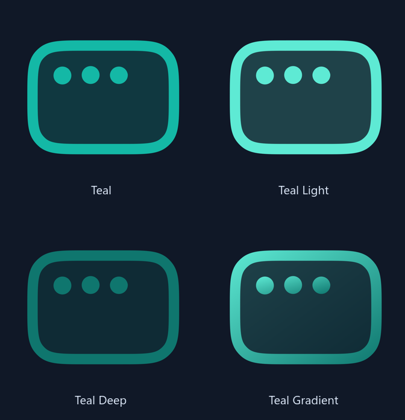

# Pirsa teal glyph icons

Transparent, glyph-only alternatives composed from
[`andrsrxn--app-window.svg`](../andrsrxn--app-window.svg). The rounded-square
background was removed and the glyph was scaled up to roughly 90% of the
1024×1024 canvas.

> The contact sheet uses a neutral `#101827` backdrop so the teal glyphs are
> visible. The SVG, PNG, and ICO files themselves have transparent backgrounds.



| Name | Glyph colour |
| --- | --- |
| Teal | `#14B8A6` |
| Teal Light | `#5EEAD4` |
| Teal Deep | `#0F766E` |
| Teal Gradient | `#5EEAD4` → `#0F766E` |

**Teal Light** is the current app and tray icon.

Each variant is available as:

- `<name>.svg` — editable transparent vector source, 1024×1024
- `<name>.png` — 512×512 transparent preview
- `<name>.ico` — multi-size Windows icon (16–256 px), transparent

Regenerate all files and the labelled contact sheet:

```powershell
powershell -ExecutionPolicy Bypass -File .\scripts\make-icon-variations.ps1
```

Requires ImageMagick 7.
